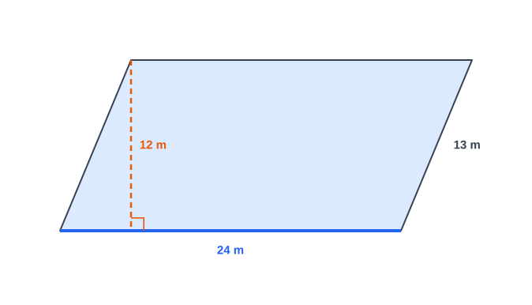
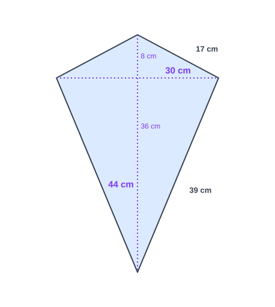
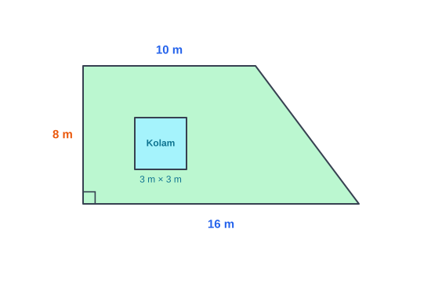
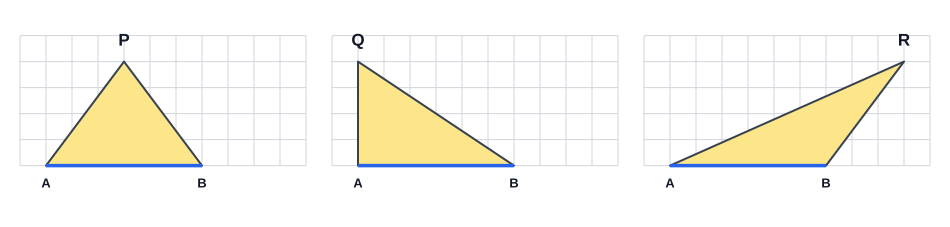
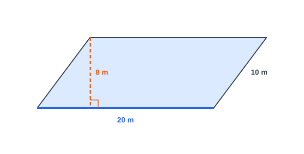
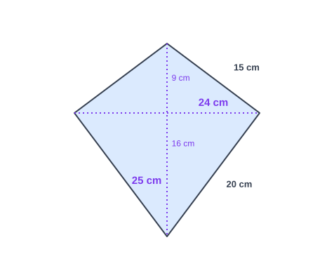
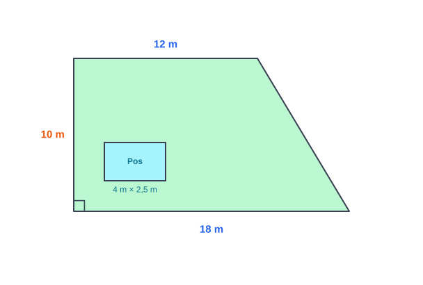
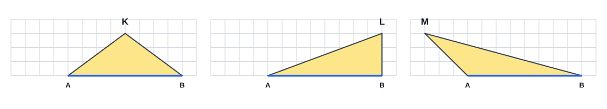

# Instrumen Pretest–Posttest Literasi Matematika
**Materi: Luas Bangun Datar · Jenjang: SMP (Fase D) · Kerangka: OECD/PISA 2022**

> **Status: DRAF untuk validasi ahli.** Semua kunci jawaban sudah dicek dengan perhitungan, tetapi butir, bahasa, dan rubrik masih perlu ditelaah validator dan diuji coba sebelum digunakan dalam penelitian.

---

## 1. Spesifikasi Instrumen

| Aspek | Ketentuan |
|---|---|
| Tujuan | Mengukur kemampuan literasi matematika siswa pada konten Ruang & Bentuk (luas bangun datar) sebelum dan sesudah menggunakan GeOnePiece |
| Bentuk | 5 unit soal kontekstual (gaya PISA) × 2 butir = **10 butir** per paket; 1 butir pilihan ganda beralasan, 9 butir uraian/isian beralasan |
| Paket | **Paket A = Pretest**, **Paket B = Posttest** — paralel (isomorfik): konstruk, proses, konteks, dan tingkat kesulitan setara; angka dan cerita berbeda |
| Waktu | 80 menit |
| Alat bantu | Kalkulator diperbolehkan (lihat PRD §15); kanvas sketsa dan Pembaca Soal tersedia tanpa umpan balik |
| Skor | Setiap butir 0–4 → skor maksimum **40**; Nilai = (skor ÷ 40) × 100 |
| Pelaporan | Skor total + subskor per proses: Penalaran (R), Merumuskan (F), Menerapkan (E), Menafsirkan & Mengevaluasi (I) |

### 1.1 Distribusi butir

| Proses | Butir | Jumlah | Bobot |
|---|---|---|---|
| Penalaran Matematis (R) | 2.1, 5.1, 5.2 | 3 | 30% |
| Merumuskan (F) | 3.1, 4.1 | 2 | 20% |
| Menerapkan (E) | 1.1, 2.2, 4.2 | 3 | 30% |
| Menafsirkan & Mengevaluasi (I) | 1.2, 3.2 | 2 | 20% |

| Konteks | Unit |
|---|---|
| Personal | 1 (lantai rumah), 3 (layang-layang/hiasan) |
| Pekerjaan | 2 (lahan pertanian) |
| Sosial/Kemasyarakatan | 4 (fasilitas sekolah), butir 5.2 (OSIS) |
| Ilmiah (intra-matematis) | butir 5.1 |

---

## 2. Kisi-Kisi

| No | Unit (A / B) | Indikator literasi (PRD §6.2) | Indikator soal | Proses | Konten | Bentuk | Level |
|---|---|---|---|---|---|---|---|
| 1.1 | Keramik Kamar Dina / Keramik Dapur Bu Sari | E1, E2 | Menghitung banyak ubin persegi untuk menutup lantai persegi panjang dengan menyamakan satuan | E | Ruang & Bentuk, Kuantitas | Isian beralasan | Sedang |
| 1.2 | idem | I2 | Mengevaluasi dua klaim tentang banyak ubin dengan mempertimbangkan cara pemasangan dan pemotongan | I | Ruang & Bentuk | Uraian | Tinggi |
| 2.1 | Lahan Pak Darto / Lahan Bu Wati | R1, E1 | Menilai kesalahan memakai sisi miring sebagai tinggi jajar genjang dan memberi alasan potong–geser | R | Ruang & Bentuk | Uraian | Sedang–tinggi |
| 2.2 | idem | E1, E2 | Menghitung biaya berdasarkan luas jajar genjang dan takaran per luas | E | Kuantitas | Isian beralasan | Sedang |
| 3.1 | Layang-layang Festival / Hiasan Kelas | F1, E1 | Memilih ukuran yang relevan (diagonal) dari informasi berlebih lalu menghitung luas layang-layang | F | Ruang & Bentuk | Isian beralasan | Sedang |
| 3.2 | idem | I1, I2 | Mengevaluasi kecukupan bahan dengan mempertimbangkan bentuk potongan, bukan hanya luas | I | Ruang & Bentuk, Kuantitas | Uraian | Tinggi |
| 4.1 | Taman Sekolah / Halaman Sekolah | F2 | Menyusun model luas daerah gabungan (trapesium dikurangi persegi/persegi panjang) | F | Ruang & Bentuk | Uraian | Sedang |
| 4.2 | idem | E1, E2, I1 | Menghitung luas & biaya, lalu memutuskan kecukupan anggaran | E | Kuantitas | Isian beralasan | Sedang |
| 5.1 | Tiga Segitiga | R1, E1 | Membandingkan luas segitiga beralas & bertinggi sama (termasuk tinggi di luar bangun) | R | Ruang & Bentuk | PG beralasan | Sedang |
| 5.2 | Bendera OSIS / Spanduk Kelas | R2 | Menalar pengaruh perubahan alas/tinggi terhadap luas segitiga | R | Ruang & Bentuk | Uraian | Tinggi |

---

## 3. Petunjuk Pengerjaan (untuk siswa)
1. Berdoalah sebelum mengerjakan.
2. Tuliskan kode siswamu.
3. Bacalah setiap cerita dengan teliti. Kamu boleh menyorot informasi penting dengan alat **Pembaca Soal**.
4. Tuliskan **cara** dan **alasanmu**, bukan hanya jawaban akhir. Kamu boleh menggambar.
5. Kamu boleh memakai kalkulator.
6. Waktu mengerjakan 80 menit.

---

## 4. PAKET A — PRETEST

### Unit A1 — Keramik Kamar Dina
Kamar Dina berbentuk persegi panjang dengan ukuran **4 m × 3 m**. Lantai kamar akan dipasangi keramik berbentuk persegi berukuran **40 cm × 40 cm**.

**A1.1** Berapa banyak keramik paling sedikit yang dibutuhkan agar seluruh lantai kamar tertutup? Tuliskan caramu.

**A1.2** Tukang keramik berkata, *"Harus beli 80 keramik, karena 300 cm tidak habis dibagi 40 cm."* Dina menjawab, *"Menurut hitunganku, 75 keramik sudah cukup."*
Menurutmu, bagaimana pendapat Dina dan pendapat tukang? Jelaskan dengan memperhatikan cara keramik dipasang di lantai.

---

### Unit A2 — Lahan Pak Darto
Pak Darto memiliki lahan berbentuk jajar genjang seperti gambar berikut.

**A2.1** Pak Darto menghitung luas lahannya: *24 × 13 = 312 m²*.
Apakah perhitungan Pak Darto benar? Jelaskan alasanmu. (Kamu boleh menggambar untuk menjelaskan.)

**A2.2** Setiap **16 m²** lahan membutuhkan **1 kg** pupuk. Harga pupuk **Rp12.000 per kg**. Berapa biaya paling sedikit yang harus dikeluarkan Pak Darto untuk memupuk seluruh lahannya? Tuliskan caramu.

---

### Unit A3 — Layang-layang Festival
Kelas 7B membuat layang-layang untuk festival. Rangka satu layang-layang berukuran seperti gambar berikut. Kertas minyak ditempel tepat menutupi bagian dalam rangka.

**A3.1** Tidak semua ukuran pada gambar diperlukan untuk menghitung luas kertas satu layang-layang. Ukuran mana yang kamu perlukan? Berapa luas kertas minyak untuk satu layang-layang?

**A3.2** Kelas 7B akan membuat **15 layang-layang**. Kertas minyak dijual per lembar berukuran **60 cm × 90 cm**. Rina menghitung:
*15 × 660 = 9.900 cm². Satu lembar = 60 × 90 = 5.400 cm². 9.900 : 5.400 ≈ 1,83. Jadi cukup membeli 2 lembar.*
Apakah 2 lembar benar-benar cukup? Berikan alasanmu dan tentukan banyak lembar yang menurutmu perlu dibeli.

---

### Unit A4 — Taman Sekolah
Sekolah memiliki taman berbentuk trapesium. Di dalam taman terdapat kolam berbentuk persegi. Seluruh bagian taman, **kecuali kolam**, akan ditanami rumput.

**A4.1** Jelaskan strategimu untuk menghitung luas bagian taman yang ditanami rumput. Tuliskan dalam bentuk kalimat atau ekspresi matematika (belum perlu dihitung).

**A4.2** Harga rumput beserta pemasangannya **Rp25.000 per m²**. Sekolah menyediakan anggaran **Rp2.500.000**. Apakah anggaran tersebut cukup? Tunjukkan perhitunganmu.

---

### Unit A5 — Segitiga
**A5.1** Perhatikan tiga segitiga P, Q, dan R pada petak satuan berikut. Ketiganya memiliki alas AB yang sama.

Pernyataan yang benar tentang luas ketiga segitiga adalah …
- A. Luas P paling besar karena bentuknya paling seimbang.
- B. Luas Q paling besar karena memiliki sudut siku-siku.
- C. Luas R paling besar karena bentuknya paling panjang.
- D. Luas ketiganya sama.

Jelaskan alasan pilihanmu.

**A5.2** OSIS membuat bendera berbentuk segitiga dengan alas **30 cm** dan tinggi **40 cm**. Ketua OSIS ingin membuat bendera baru yang luasnya **dua kali** luas bendera lama.
- Andi berkata: *"Kalikan saja alas dan tingginya masing-masing dengan 2."*
- Budi berkata: *"Cukup alasnya saja yang dikalikan 2, tingginya tetap."*

Siapa yang benar? Jelaskan alasanmu dengan perhitungan.

---

## 5. PAKET B — POSTTEST

### Unit B1 — Keramik Dapur Bu Sari
Dapur Bu Sari berbentuk persegi panjang dengan ukuran **3,3 m × 2,4 m**. Lantai dapur akan dipasangi keramik berbentuk persegi berukuran **60 cm × 60 cm**.

**B1.1** Berapa banyak keramik paling sedikit yang dibutuhkan agar seluruh lantai dapur tertutup? Tuliskan caramu.

**B1.2** Tukang keramik berkata, *"Harus beli 24 keramik, karena 330 cm tidak habis dibagi 60 cm."* Bu Sari menjawab, *"Menurut hitunganku, 22 keramik sudah cukup."*
Menurutmu, bagaimana pendapat Bu Sari dan pendapat tukang? Jelaskan dengan memperhatikan cara keramik dipasang di lantai.

---

### Unit B2 — Lahan Sayur Bu Wati
Bu Wati memiliki lahan sayur berbentuk jajar genjang seperti gambar berikut.

**B2.1** Bu Wati menghitung luas lahannya: *20 × 10 = 200 m²*.
Apakah perhitungan Bu Wati benar? Jelaskan alasanmu. (Kamu boleh menggambar untuk menjelaskan.)

**B2.2** Setiap **10 m²** lahan membutuhkan **1 bungkus** benih. Harga benih **Rp15.000 per bungkus**. Berapa biaya paling sedikit untuk membeli benih bagi seluruh lahan? Tuliskan caramu.

---

### Unit B3 — Hiasan Kelas
Siswa kelas 8A membuat hiasan dinding dari karton berbentuk layang-layang dengan ukuran seperti gambar berikut.

**B3.1** Tidak semua ukuran pada gambar diperlukan untuk menghitung luas satu hiasan. Ukuran mana yang kamu perlukan? Berapa luas karton untuk satu hiasan?

**B3.2** Kelas 8A akan membuat **20 hiasan**. Karton dijual per lembar berukuran **50 cm × 60 cm**. Siti menghitung:
*20 × 300 = 6.000 cm². Satu lembar = 50 × 60 = 3.000 cm². 6.000 : 3.000 = 2. Jadi cukup membeli 2 lembar.*
Apakah 2 lembar benar-benar cukup? Berikan alasanmu dan tentukan banyak lembar yang menurutmu perlu dibeli.

---

### Unit B4 — Halaman Sekolah
Halaman parkir sekolah berbentuk trapesium. Di dalamnya terdapat pos satpam berbentuk persegi panjang. Seluruh halaman, **kecuali pos satpam**, akan dipasangi paving block.

**B4.1** Jelaskan strategimu untuk menghitung luas bagian halaman yang dipasangi paving block. Tuliskan dalam bentuk kalimat atau ekspresi matematika (belum perlu dihitung).

**B4.2** Harga paving block beserta pemasangannya **Rp85.000 per m²**. Sekolah menyediakan anggaran **Rp12.000.000**. Apakah anggaran tersebut cukup? Tunjukkan perhitunganmu.

---

### Unit B5 — Segitiga
**B5.1** Perhatikan tiga segitiga K, L, dan M pada petak satuan berikut. Ketiganya memiliki alas AB yang sama.

Pernyataan yang benar tentang luas ketiga segitiga adalah …
- A. Luas K paling besar karena puncaknya tepat di tengah.
- B. Luas L paling besar karena memiliki sudut siku-siku.
- C. Luas M paling besar karena sisi miringnya paling panjang.
- D. Luas ketiganya sama.

Jelaskan alasan pilihanmu.

**B5.2** Kelas 9C membuat spanduk berbentuk segitiga dengan alas **50 cm** dan tinggi **20 cm**. Mereka ingin membuat spanduk kecil yang luasnya **setengah** luas spanduk tersebut.
- Dewi berkata: *"Bagi dua saja alas dan tingginya masing-masing."*
- Eko berkata: *"Cukup tingginya saja yang dibagi dua, alasnya tetap."*

Siapa yang benar? Jelaskan alasanmu dengan perhitungan.

---

## 6. Kunci Jawaban & Pedoman Penskoran

### 6.1 Rubrik umum (skor 0–4 per butir)

| Skor | Penalaran (R) | Merumuskan (F) | Menerapkan (E) | Menafsirkan & Mengevaluasi (I) |
|---|---|---|---|---|
| **4** | Kesimpulan benar dengan argumen matematis lengkap dan runtut | Model/strategi tepat dan lengkap; informasi relevan dipilih dengan benar | Prosedur, perhitungan, dan satuan benar | Hasil ditafsirkan dalam konteks dan klaim dievaluasi dengan alasan yang kuat |
| **3** | Kesimpulan benar, argumen benar tetapi kurang lengkap | Model tepat dengan kekurangan kecil | Prosedur benar, ada kesalahan hitung/satuan kecil | Penafsiran benar, alasan kurang lengkap |
| **2** | Kesimpulan benar tanpa alasan, atau alasan sebagian benar | Sebagian model benar | Strategi benar, tetapi perhitungan berhenti/banyak salah | Menyadari ada masalah tetapi tidak menjelaskannya |
| **1** | Kesimpulan salah, tetapi ada langkah/alasan yang relevan | Ada upaya mengidentifikasi informasi, model belum tepat | Ada upaya prosedur yang relevan | Ada upaya menafsirkan tanpa dasar yang benar |
| **0** | Tidak menjawab / tidak relevan | Tidak menjawab / tidak relevan | Tidak menjawab / tidak relevan | Tidak menjawab / tidak relevan |

### 6.2 Kunci per butir

| Butir | Kunci Paket A | Kunci Paket B | Catatan penskoran khusus |
|---|---|---|---|
| **1.1** (E) | 4 m × 3 m = 400 cm × 300 cm = 120.000 cm²; satu keramik 1.600 cm²; 120.000 ÷ 1.600 = **75 keramik** | 330 cm × 240 cm = 79.200 cm²; satu keramik 3.600 cm²; 79.200 ÷ 3.600 = **22 keramik** | Cara per baris juga benar (A: 10 × 7,5 = 75; B: 5,5 × 4 = 22). Skor 3 bila menjawab 80 (A) / 24 (B) dengan cara pembulatan per baris yang dijelaskan. Skor 2 bila lupa menyamakan satuan tetapi strategi benar. |
| **1.2** (I) | Ke arah 3 m muat 7,5 keramik → 7 baris utuh (70 keramik) + 1 baris setengah keramik (10 potongan 40 × 20 cm). Satu keramik yang dipotong dua menghasilkan **dua** potongan yang sama-sama terpakai → baris terakhir butuh 5 keramik. **75 cukup** bila potongan dimanfaatkan dan tidak ada yang pecah. Tukang menghitung 80 karena menganggap setiap potongan menyisakan sisa terbuang / sebagai cadangan. | Ke arah 3,3 m muat 5,5 keramik → 4 baris × 5 keramik utuh (20) + 4 potongan setengah (60 × 30 cm) = 2 keramik → **22 cukup** bila potongan dimanfaatkan. Tukang menghitung 24 karena setiap potongan dianggap sisa / cadangan. | Skor 4: menjelaskan pemanfaatan potongan **dan** alasan tukang (sisa/cadangan pecah). Skor 3: salah satu pendapat dijelaskan dengan benar. Skor 2: hanya menyatakan pendapat tanpa alasan pemasangan. Pendapat "beli lebih untuk cadangan" diterima sebagai evaluasi yang wajar. |
| **2.1** (R) | **Salah.** Luas jajar genjang = alas × **tinggi**, dan tinggi harus tegak lurus alas: 24 × 12 = **288 m²**. 13 m adalah sisi miring. Alasan potong–geser: potong segitiga di satu sisi, pindahkan ke sisi lain → persegi panjang 24 m × 12 m. | **Salah.** 20 × 8 = **160 m²**; 10 m adalah sisi miring. Alasan potong–geser yang sama. | Skor 4: "salah" + luas benar + alasan konseptual (tinggi ⟂ alas / potong–geser / persegi panjang yang terbentuk lebih pendek dari sisi miring). Skor 3: "salah" + luas benar + alasan hanya "rumusnya a × t". Skor 2: "salah" tanpa alasan atau luas salah. |
| **2.2** (E) | 288 ÷ 16 = 18 kg; 18 × Rp12.000 = **Rp216.000** | 160 ÷ 10 = 16 bungkus; 16 × Rp15.000 = **Rp240.000** | Jika memakai luas salah dari 2.1 (312 / 200) tetapi prosedur benar → **skor 3** (konsekuensi kesalahan sebelumnya tidak dihukum dua kali). |
| **3.1** (F) | Yang diperlukan: **kedua diagonal** (30 cm dan 44 cm). Panjang sisi (17 cm, 39 cm) tidak diperlukan. L = (30 × 44) ÷ 2 = **660 cm²** | Diagonal **24 cm dan 25 cm**; sisi 15 cm dan 20 cm tidak diperlukan. L = (24 × 25) ÷ 2 = **300 cm²** | Skor 4: memilih diagonal + luas benar. Skor 3: luas benar tanpa menyebut ukuran yang tidak diperlukan. Skor 2: memakai diagonal tetapi lupa ÷ 2. Skor 1: memakai sisi. |
| **3.2** (I) | **Tidak cukup** (secara praktis). Luas 1,83 lembar adalah batas minimum teoretis; bentuk layang-layang tidak dapat disusun menutupi kertas tanpa sisa. Jika tiap layang-layang dipotong dari persegi panjang 30 × 44 cm, satu lembar 60 × 90 memuat 2 × 2 = 4 layang-layang → 15 ÷ 4 = 3,75 → **4 lembar**. | **Tidak cukup.** Luas pas 2 lembar hanya berlaku jika tidak ada sisa sama sekali. Tiap hiasan butuh persegi panjang 24 × 25 cm; satu lembar 50 × 60 memuat 2 × 2 = 4 hiasan → 20 ÷ 4 = **5 lembar**. | Skor 4: menolak klaim + alasan bentuk/sisa potongan + jumlah lembar yang dibenarkan dengan susunan. Jawaban lain (mis. 3 lembar) diterima jika disertai susunan potong yang masuk akal. Skor 3: menolak klaim dengan alasan sisa tanpa jumlah yang dibenarkan. Skor 2: hanya membulatkan (A: 1,83 → 2) dengan menyebut "lebih baik dilebihkan". Skor 1: menerima klaim dengan perhitungan ulang benar. |
| **4.1** (F) | Luas rumput = luas trapesium − luas kolam = [(10 + 16) ÷ 2 × 8] − (3 × 3) | Luas paving = luas trapesium − luas pos = [(12 + 18) ÷ 2 × 10] − (4 × 2,5) | Skor 4: strategi selisih dengan rumus yang tepat. Skor 3: strategi selisih benar, satu rumus kurang tepat. Skor 2: hanya menghitung trapesium tanpa mengurangi. Strategi memecah menjadi persegi panjang + segitiga juga diterima. |
| **4.2** (E) | 104 − 9 = 95 m²; 95 × Rp25.000 = Rp2.375.000 ≤ Rp2.500.000 → **cukup**, sisa Rp125.000 | 150 − 10 = 140 m²; 140 × Rp85.000 = Rp11.900.000 ≤ Rp12.000.000 → **cukup**, sisa Rp100.000 | Skor 4 memerlukan keputusan "cukup" yang dikaitkan dengan anggaran. Tanpa keputusan → maksimal 3. Bila lupa mengurangi kolam/pos: A → 104 m² = Rp2.600.000 → "tidak cukup"; B → 150 m² = Rp12.750.000 → "tidak cukup"; skor 2. |
| **5.1** (R) | **D.** Alas sama (6 satuan) dan tinggi sama (4 satuan) → luas masing-masing ½ × 6 × 4 = 12 satuan². Tinggi R berada di luar segitiga tetapi panjangnya tetap 4. | **D.** Alas 8, tinggi 3 → masing-masing 12 satuan². Tinggi M berada di luar segitiga. | Skor 4: D + alasan alas & tinggi sama (atau menghitung ketiganya). Skor 3: D + menghitung sebagian. Skor 2: D tanpa alasan. Skor 1: pilihan salah tetapi menghitung minimal satu luas dengan benar. |
| **5.2** (R) | **Budi.** Luas lama ½ × 30 × 40 = 600 cm². Cara Budi: ½ × 60 × 40 = 1.200 cm² (2 kali). Cara Andi: ½ × 60 × 80 = 2.400 cm² (**4 kali**). | **Eko.** Luas lama ½ × 50 × 20 = 500 cm². Cara Eko: ½ × 50 × 10 = 250 cm² (setengah). Cara Dewi: ½ × 25 × 10 = 125 cm² (**seperempat**). | Skor 4: memilih benar + menghitung kedua cara + menyimpulkan kelipatannya. Alasan umum (luas sebanding dengan alas dan tinggi; dua-duanya dikali 2 → 2 × 2 = 4) juga skor 4. Skor 2: memilih benar tanpa perhitungan. Jawaban "keduanya benar" → skor 1. |

---

## 7. Lembar Validasi Ahli (ringkas)

Skala penilaian 1–4 (1 = tidak sesuai, 4 = sangat sesuai) untuk setiap butir:

| Aspek | Pernyataan |
|---|---|
| **Isi** | 1. Butir sesuai dengan indikator literasi matematika pada kisi-kisi |
| | 2. Butir sesuai dengan proses PISA yang dimaksud (R/F/E/I) |
| | 3. Konteks soal realistis dan dekat dengan kehidupan siswa SMP |
| | 4. Materi sesuai dengan CP/ATP luas bangun datar |
| **Konstruksi** | 5. Gambar jelas, ukuran terbaca, dan sesuai dengan cerita |
| | 6. Kunci jawaban dan rubrik penskoran jelas dan dapat diterapkan |
| | 7. Butir paket A dan B setara (isomorfik) |
| **Bahasa** | 8. Kalimat menggunakan Bahasa Indonesia yang baik dan benar |
| | 9. Kalimat tidak berbelit-belit dan tidak menimbulkan tafsiran ganda |
| | 10. Panjang teks sesuai untuk siswa SMP |

Kolom saran perbaikan disediakan untuk setiap butir.

---

## 8. Rencana Analisis Instrumen

| Tahap | Analisis | Rumus/kriteria |
|---|---|---|
| Validitas isi | **Aiken's V** | V = Σs ÷ [n(c − 1)], s = r − l₀ (r = skor validator, l₀ = skor terendah, c = banyak kategori, n = banyak validator). Bandingkan dengan nilai kritis tabel Aiken sesuai n dan c. |
| Uji coba (kelas di luar sampel) | Validitas butir | Korelasi *product moment* skor butir–skor total; valid jika r hitung > r tabel (α = 0,05) |
| | Reliabilitas | **Cronbach's alpha**; reliabel jika α ≥ 0,70 |
| | Tingkat kesukaran (uraian) | P = rata-rata skor butir ÷ skor maksimum; 0,00–0,30 sukar · 0,31–0,70 sedang · 0,71–1,00 mudah |
| | Daya pembeda (uraian) | DP = (rata-rata kelompok atas − rata-rata kelompok bawah) ÷ skor maksimum, kelompok 27%; ≥ 0,40 sangat baik · 0,30–0,39 baik · 0,20–0,29 cukup (revisi) · < 0,20 buang/revisi total |
| | Kesetaraan paket A–B | Kelompok uji coba mengerjakan kedua paket (urutan diselang-seling/*counterbalanced*); bandingkan rata-rata (uji-t berpasangan, diharapkan tidak berbeda signifikan) dan korelasi skor A–B |
| | Reliabilitas antar-penilai | Dua penilai menskor 20–30% lembar jawaban; Cohen's kappa / ICC |
| Uji lapangan | Efektivitas | N-gain = (post − pre) ÷ (40 − pre); kategori Hake: g ≥ 0,7 tinggi · 0,3 ≤ g < 0,7 sedang · g < 0,3 rendah. Uji normalitas → *paired t-test* atau Wilcoxon; ukuran efek Cohen's d. Analisis juga per proses (R, F, E, I). |

Semua analisis ini disiapkan sebagai skrip Python di `services/api/app/analysis/` dan `analysis/notebooks/`.

---

## 9. Catatan untuk Pengembangan Aplikasi
- Butir disimpan di `content/items/tests/paket-a.json` & `paket-b.json`; kunci dan rubrik di `content/keys/` (hanya dibaca API).
- Gambar di `docs/figures/` sudah memakai kode warna aplikasi (alas biru, tinggi oranye putus-putus dengan tanda siku, diagonal ungu titik-titik) agar konsisten antara latihan dan tes.
- Soal tes **tidak boleh** muncul di modul belajar/latihan. Latihan memakai konteks dan angka yang berbeda.
